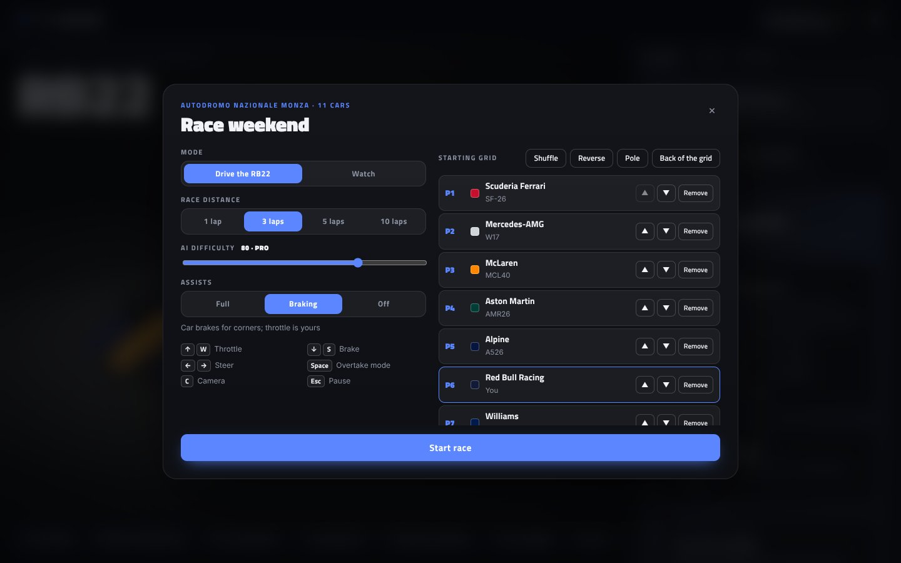
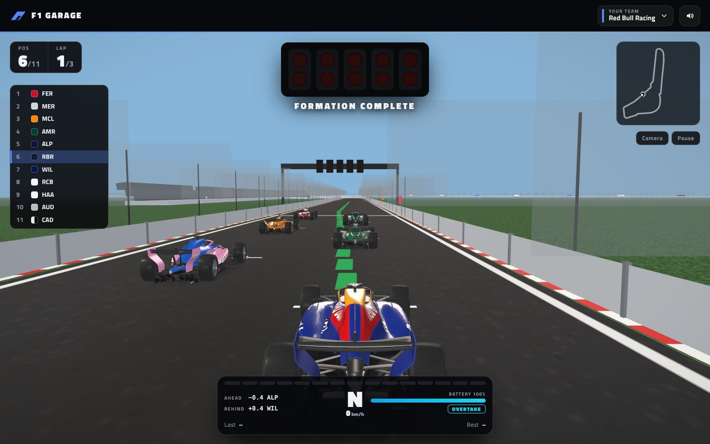

# F1 Garage

**Understand Formula 1's 2026 cars by taking them apart, with an AI race engineer at your side.**


Built for the Nebius Global AI Hackathon · AI engineer on **NVIDIA Nemotron** via **Nebius Token Factory** · Next.js, React Three Fiber

## Why I built this

I'm a huge Formula 1 fan, and the sport gets more technical every year. The 2026 rules are the biggest change in a generation: new power units with nearly half the power electric, active aerodynamics, Overtake mode, energy to manage every lap. Even commentators and drivers say the new cars are hard to follow, so for fans without an engineering background it's harder still.

**F1 Garage lets any fan open up a 2026 car, see how it works and ask questions in plain words until it makes sense.** Every figure comes from a real source (FIA regulations, team declarations, F1 media), and the app shows where.

## What's inside

**Lena, the AI race engineer**
- Ask anything in plain words: *"Why does the 2026 car have active aero?"*, *"What did Red Bull change in Miami?"*
- She picks her own tools (FIA rules, team upgrades, live timing, standings, news) and cites her sources.
- She shows you while she talks: takes parts off the car, highlights them, switches to X-ray or airflow.
- Fan or Engineer depth, six guided lessons, and a natural voice with captions.

**The garage**
- All 11 teams of the 2026 grid, each car in its 2026 livery.
- Take any part off, or explode the whole car into its pieces.
- X-ray view with FIA dimensions, airflow streamlines, and a power-unit cutaway.

**The fun part**
- **Showcase:** a narrated reveal where the car comes apart, rebuilds and launches.
- **Race:** a race weekend like the F1 games at Monza, with lights, a timing tower, Overtake mode and Lena on the radio.
- **Guided lap:** watch the 2026 systems work, aero modes switching and the battery charging and deploying.

## Screenshots

| | |
|:---:|:---:|
|  |  |
| Choose your team | Take it apart |
|  |  |
| Power-unit cutaway | X-ray view |
|  |  |
| Race setup | Racing at Monza |

## Where AI is used

| Feature | Powered by |
|---|---|
| Lena's answers and her control of the 3D car | NVIDIA Nemotron on Nebius Token Factory, as a tool-using agent |
| Lena's voice | Microsoft neural text-to-speech |
| Team news and briefings | Not AI: web search (Tavily) quoting FIA, F1 media and team sites |

## Run it

```bash
cp .env.example .env.local   # add NEBIUS_API_KEY, NEBIUS_MODEL and TAVILY_API_KEY
npm install
npm run dev                  # http://localhost:3002
```

The licensed 3D car isn't in the repository; without it, a car modelled in code is shown. See [docs/TECHNICAL.md](docs/TECHNICAL.md#about-the-3d-model).

**More:** the agent's design, tools, code map, caching, sound and 3D model are in [docs/TECHNICAL.md](docs/TECHNICAL.md).

## License

Code under the [MIT License](LICENSE). Third-party assets keep their own licences ([THIRD_PARTY_NOTICES.md](THIRD_PARTY_NOTICES.md)). An unofficial fan project, not affiliated with Formula 1, the FIA or any team.
