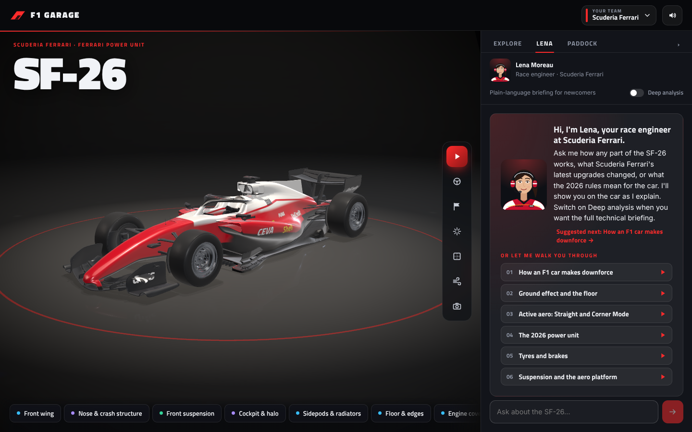

<div align="center">

# 🏎️ F1 Garage

### Take a 2026 Formula 1 car apart, piece by piece, while an AI race engineer explains it all.

**Explode the car. X-ray it. Watch the air flow. Race it at Monza.**
And ask Lena anything until it finally clicks.

[](#)
[](#where-ai-is-used)
[](#where-ai-is-used)
[](#run-it)
[](#run-it)
[](LICENSE)


<!-- Tip: replace the hero image with a 5–10 s GIF of the car exploding apart. It's the single biggest upgrade for this README. -->

</div>

---

## 🔥 2026 changed everything. Most fans got left behind.

The 2026 regulations are the biggest shake-up in a generation:

- ⚡ **Nearly half the power is now electric**
- 🪽 **Active aerodynamics**: wings that change shape on the straights
- 🚀 **Overtake mode** replacing DRS
- 🔋 **Energy management on every single lap**

Even commentators and drivers say the new cars are hard to follow. For fans without an engineering background, it can feel impossible.

**F1 Garage fixes that.** Open up any 2026 car, see how it actually works, and ask questions in plain words until it makes sense. Every number comes from a real source (FIA regulations, team declarations, F1 media), and the app shows you exactly where.

---

## 🎧 Meet Lena, your AI race engineer

> **You:** "What did Ferrari bring to Miami?"
>
> **Lena:** *pulls the declared upgrade list, lights up the front wing, floor, diffuser and rear wing on the SF-26, and walks you through the eleven-part package, with sources.*

Lena doesn't just answer. **She shows you.**

<div align="center">

</div>

| | |
|---|---|
| 🧠 **Thinks for herself** | Picks her own tools: FIA rules, team upgrades, live timing, standings, news |
| 🔧 **Drives the 3D car** | Pulls parts off, highlights them, switches to X-ray or airflow as she talks |
| 📚 **Cites her sources** | Every answer comes with the links it was built from |
| 🎚️ **Speaks your language** | *Fan* mode for one-liners, *Engineer* mode for the full detail |
| 🎓 **Teaches** | Six guided lessons, from downforce to the 2026 power unit |
| 🗣️ **Talks back** | Natural voice with live captions |

Try asking:
- *"What's in Ferrari's Monza drag package?"*
- *"Why does the SF-26 have active aero?"*
- *"How does Overtake mode actually work?"*

---

## 🛠️ The garage

- 🏁 **All 11 teams** of the 2026 grid, each in its 2026 livery
- 💥 **Take any part off**, or explode the whole car into pieces
- 🩻 **X-ray view** with official FIA dimensions
- 🌬️ **Airflow streamlines** to see the aero at work
- ⚙️ **Power-unit cutaway** to look inside the hybrid heart

<div align="center">

| Choose your team | Take it apart |
|:---:|:---:|
|  |  |
| **Power-unit cutaway** | **X-ray view** |
|  |  |

</div>

---

## 🏆 The fun part

### 🎬 Showcase
A narrated reveal: the car blows apart, rebuilds itself, and launches.

### 🚦 Race weekend at Monza
Five red lights. A live timing tower. Overtake mode. Lena on the radio. Just like the F1 games.

### 🔄 Guided lap
Watch the 2026 systems come alive: aero modes flipping, the battery harvesting and deploying, corner by corner.

<div align="center">

| Race setup | Racing at Monza |
|:---:|:---:|
|  |  |

</div>

---

## 🤖 Where AI is used

Lena runs on an **NVIDIA Nemotron** open model (default `nvidia/NVIDIA-Nemotron-3-Nano-30B-A3B`, any tool-calling Nemotron works), served by **Nebius Token Factory** through its OpenAI-compatible API (`https://api.tokenfactory.nebius.com/v1/`).

**One Nemotron agent does everything:**

| What Nemotron does | Example (Ferrari fan) | Code |
|---|---|---|
| 🧭 Understands the question and plans which tools to call | "What did Ferrari bring to Miami?" → calls `get_team_upgrades` for Ferrari | `lib/server/agent/run.ts` |
| ⚡ Calls tools **in parallel** for live facts: FIA rules, declared upgrades, live timing, standings, news | Finds the eleven-part Miami package and its source | `lib/server/agent/tools.ts` |
| 🎮 **Drives the 3D car** while it explains | Lights up the front wing, floor, diffuser and rear wing on the SF-26 | `focus_part`, `highlight_parts`, `set_view` |
| 🎚️ Explains at your level | One line for a fan, full detail for an engineer | `lib/server/agent/prompt.ts` |
| 🧠 **Deep analysis** with Nemotron's reasoning mode, shown in a collapsible block | "Why did Ferrari need a drag package for Monza?" | `chat_template_kwargs: { enable_thinking: true }` |

**Not Nemotron:** Lena's voice is Microsoft neural text-to-speech, and team news is plain web search (Tavily) quoting FIA, F1 media and team sites. Lessons, the showcase and race radio are written lines.

### 🧪 Other models I explored

| Model | What for | Status |
|---|---|---|
| **Larger Nemotrons** (Nemotron 3 Super, Nemotron Ultra) on Nebius Token Factory | Richer explanations and more reliable tool calls | Supported: set `NEBIUS_MODEL` to any tool-calling Nemotron your account lists |
| **NVIDIA PartPacker** | Generate the 3D car from a single image, already split into parts | Tried; its public demo was down, so the app uses a licensed model. The code still loads PartPacker output |
| **Hunyuan3D / TRELLIS** | Image-to-3D car as one mesh, sliced into parts by region | Supported as a fallback (`public/models/README.md`) |
| **NVIDIA Audio2Face** | Realistic facial animation for Lena | Planned: today Lena's mouth follows her live voice (jaw and mouth shapes from the audio) |

---

## ⚡ How Nebius Token Factory accelerated the build

**Token Factory is the only Nebius service used.** It made the AI part of the project fast to build:

- **No infrastructure.** Nemotron runs as a hosted endpoint, so no GPUs to rent, no model weights to download and no inference server to run. The whole hackathon went into the product, not the plumbing.
- **Drop-in OpenAI compatibility.** The standard `openai` SDK works by changing only `baseURL` (`lib/server/agent/run.ts`). Streaming, tool calling and `parallel_tool_calls` worked out of the box.
- **Swap models with one variable.** `NEBIUS_MODEL` selects any Nemotron from `GET /v1/models`, so trying a larger model is a config change, not a code change.
- **Reasoning on demand.** Nemotron's thinking mode is switched per question with `chat_template_kwargs: { enable_thinking }`, which powers the *Deep analysis* toggle.

## 💬 Feedback

**Nebius Token Factory**
- 👍 OpenAI compatibility made integration take minutes, and streaming with tool calls was reliable.
- 👍 Being able to list models through the API made it easy to find which Nemotrons my account could use.
- 🔧 Model ids vary by account, so a hard-coded id can return "not found". A stable alias per model family (e.g. `nemotron-latest`) would help.
- 🔧 Not every deployment accepts `chat_template_kwargs`, so the app retries without it. Documenting which models support thinking control would save that guesswork.
- 🔧 Reasoning arrives either in `reasoning_content` or inline as `<think>…</think>` depending on the model, so the app handles both. One consistent field would be simpler.

**NVIDIA models and tools**
- 👍 Nemotron follows the tool schema well: it reliably chooses between looking things up and moving the 3D car.
- 👍 The open Nemotron family gives a clear upgrade path, from Nano for speed to Super and Ultra for depth.
- 🔧 The public NVIDIA PartPacker demo on Hugging Face failed with a ZeroGPU runtime error while I was building, so I couldn't generate the car from an image. A hosted endpoint for it (for example on Token Factory) would make it usable in projects like this.

**Nebius AI Cloud**
- Not used in this project: everything ran on Token Factory's hosted models.

---

## 🚀 Run it

```bash
cp .env.example .env.local   # add NEBIUS_API_KEY, NEBIUS_MODEL and TAVILY_API_KEY
npm install
npm run dev                  # → http://localhost:3002
```

> The licensed 3D car isn't in the repository. Without it, a car modelled in code is shown. See [`docs/TECHNICAL.md`](docs/TECHNICAL.md).

**Under the hood:** the agent's design, tools, code map, caching, sound and 3D model are all in [`docs/TECHNICAL.md`](docs/TECHNICAL.md).

---

## 💭 Why I built this

I'm a huge Formula 1 fan (and a Ferrari fan), and the sport gets more technical every year. With the 2026 rules, even people who follow every race struggle to explain what the cars are doing. I wanted every fan, not just the engineers, to be able to open up a 2026 car, ask questions without feeling silly, and finally understand what they're watching.

---

<div align="center">

**Built for the Nebius Global AI Hackathon** · NVIDIA Nemotron on Nebius Token Factory · Next.js · React Three Fiber

Code under the [MIT License](LICENSE). Third-party assets keep their own licences ([THIRD_PARTY_NOTICES.md](THIRD_PARTY_NOTICES.md)).
*An unofficial fan project, not affiliated with Formula 1, the FIA or any team.*

</div>
